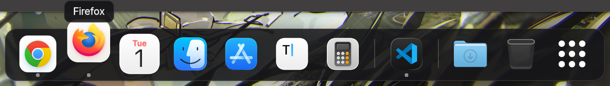
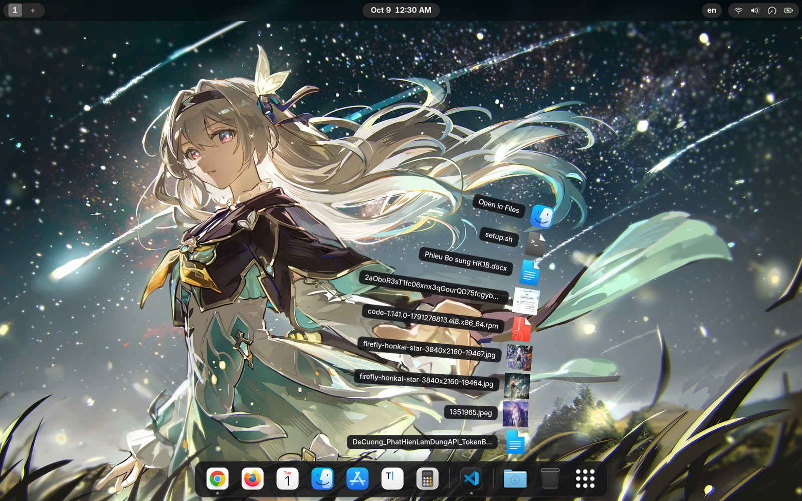

# GlideDock

A small, smooth dock for GNOME Shell with magnifying icons and pinned, running, Trash and Downloads items.






## Features

- Magnifying icons that follow the pointer, without relayout
- Pinned and running apps, with running indicators
- Trash and Downloads at the end of the dock; click the Downloads folder to fan out its latest files
- Bottom, left or right edge, with optional intellihide
- Can replace the overview dash
- Launch bounce and minimize-into-icon animations
- English and Vietnamese translations

## Requirements

- GNOME Shell 45, 46, 47, 48, 49, 50 or 51 (on 51 the blur background has square corners)
- To build: `gnome-extensions`, `glib-compile-schemas`, `gjs`, `msgfmt`, `zip`, `unzip`, `python3`

```bash
# Fedora
sudo dnf install gnome-shell glib2 gjs gettext zip unzip python3

# Debian / Ubuntu
sudo apt install gnome-shell libglib2.0-bin gjs gettext zip unzip python3
```

## Install

```bash
git clone https://github.com/bquangthien25-hub/GlideDock.git
cd GlideDock
./build.sh --install
```

Then restart GNOME Shell so it loads the new code:

- **X11:** press `Alt` + `F2`, type `r`, press `Enter`.
- **Wayland:** log out and log back in.

Enable the extension:

```bash
gnome-extensions enable glidedock@bquangthien25.github.io
```

## Configure

Open the preferences from the Extensions app, or run:

```bash
gnome-extensions prefs glidedock@bquangthien25.github.io
```

## Uninstall

```bash
gnome-extensions disable glidedock@bquangthien25.github.io
gnome-extensions uninstall glidedock@bquangthien25.github.io
```

## Bugs

Report them at <https://github.com/bquangthien25-hub/GlideDock/issues> with your GNOME Shell version and the output of `journalctl --user -b -g glidedock`.

## License

GPL-2.0-or-later. See [LICENSE](LICENSE).
