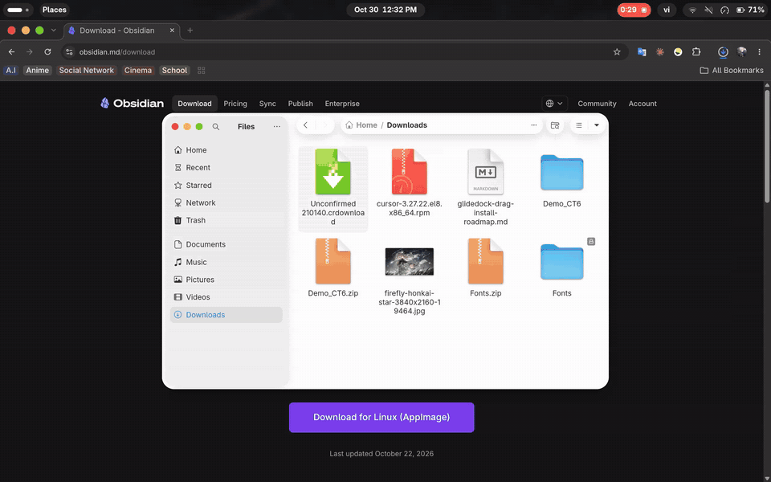

# GlideDock

A small, smooth dock for GNOME Shell with magnifying icons and pinned, running, Trash and Downloads items.


## Features

- Magnifying icons that follow the pointer, without relayout
- Pinned and running apps, with running indicators
- Trash and Downloads at the end of the dock; click the Downloads folder to fan out its latest files
- Bottom, left or right edge, with optional intellihide
- Can replace the overview dash
- Launch bounce and minimize-into-icon animations
- Drag-and-drop install: drop an AppImage, Flatpak, RPM or DEB file on the dock to install the app and pin it
- English and Vietnamese translations

## Drag-and-Drop Install

Drag an app file onto the dock to install it, much like dragging an app into Applications on macOS.



1. Drag the file onto the dock, from Files or from the Firefox downloads list.
2. The dock lights up **blue** if the file can be installed, or **red** if it cannot.
3. Drop it and confirm.
4. A placeholder with a spinner shows up in the dock while the app installs. When it is done, the app's own icon takes its place and a notification says so.

Drag-to-install is **off by default**. Turn it on in the extension settings: Preferences → Behavior → Drop to install.

| File | How it is installed | Root |
|---|---|---|
| `.AppImage` | Made executable (`chmod +x`), moved to `~/Applications`, and given a `.desktop` launcher with its own name and icon, created automatically | No |
| `.flatpakref`, `.flatpak` | `flatpak install --user -y`. The app's permissions are not shown before installing; check them afterwards with `flatpak info --show-permissions <app-id>` | No |
| `.rpm` | `pkexec dnf install -y`; GNOME shows a password prompt. dnf does not check the signature of a package file, so GlideDock checks it first with `rpm --checksig` and warns in the confirm dialog if the package is unsigned, signed with a key your system does not trust, or does not match its signature | Yes |
| `.deb` | `pkexec apt install -y`; GNOME shows a password prompt. The dialog shows the package name and description from `dpkg-deb --info`. apt does not check the signature of a package file either, so GlideDock checks it with `dpkg-sig --verify` and warns if it is unsigned or not trusted. Without `dpkg-sig` (most systems), the dialog says the signature could not be verified | Yes |

Tested on: GNOME 47–51 (Fedora 44). DEB support has only been tested with stand-ins for `apt` and `dpkg`, not yet on Debian or Ubuntu.

Good to know:

- **Updates:** dropping an app that is already installed replaces it. GlideDock asks before it does. An older AppImage of the same app goes to the Trash.
- **Nothing is replaced without asking:** GlideDock asks first if `~/Applications` already has a file of the same name that it did not install (that file then goes to the Trash), or if an AppImage carries the same launcher as another installed AppImage, which would take over that app's dock icon.
- **One at a time:** if you drop more files while an app is installing, they wait their turn.
- **Errors** show up as a notification that says what went wrong, such as a missing Flatpak runtime, a missing RPM dependency, or a package signature that is not trusted. Where there is a fix, the notification gives the command to run.

Removing an installed app:

```bash
# AppImage: delete the file and its launcher
rm ~/Applications/<App>.AppImage ~/.local/share/applications/glidedock-<app>.desktop

# Flatpak
flatpak uninstall --user <app id>

# RPM
sudo dnf remove <package>

# DEB
sudo apt remove <package>
```

<details>
<summary>How it works</summary>

On Wayland, GNOME Shell cannot receive files dropped by other apps; only a window can. So while you drag something towards the dock, GlideDock opens a small, invisible window over it to catch the drop (`helper/dropTarget.js`), and closes it when the drag ends. Installs run as separate processes, so the shell never waits for them.

</details>

## Requirements

- GNOME Shell 45, 46, 47, 48, 49, 50 or 51 (on 51 the blur background has square corners)
- For drag-and-drop install: `gjs` with GTK 4 (installed with GNOME), plus `flatpak` for Flatpak files, `dnf` and `pkexec` for RPM files (Fedora and other dnf-based systems), and `apt` and `pkexec` for DEB files (Debian, Ubuntu and systems based on them). Dropping a package your system cannot install, such as an RPM on Ubuntu or a DEB on Fedora, shows that it is not supported
- To build: `gnome-extensions`, `glib-compile-schemas`, `gjs`, `msgfmt`, `zip`, `unzip`, `python3`

```bash
# Fedora
sudo dnf install gnome-shell glib2 gjs gettext zip unzip python3

# Debian / Ubuntu
sudo apt install gnome-shell libglib2.0-bin gjs gettext zip unzip python3
```

## Install

```bash
git clone https://github.com/bquangthien25-hub/GlideDock.git
cd GlideDock
./build.sh --install
```

Then restart GNOME Shell so it loads the new code:

- **X11:** press `Alt` + `F2`, type `r`, press `Enter`.
- **Wayland:** log out and log back in.

Enable the extension:

```bash
gnome-extensions enable glidedock@bquangthien25.github.io
```

## Configure

Open the preferences from the Extensions app, or run:

```bash
gnome-extensions prefs glidedock@bquangthien25.github.io
```

## Uninstall

```bash
gnome-extensions disable glidedock@bquangthien25.github.io
gnome-extensions uninstall glidedock@bquangthien25.github.io
```

## Bugs

Report them at <https://github.com/bquangthien25-hub/GlideDock/issues> with your GNOME Shell version and the output of `journalctl --user -b -g glidedock`.

## License

GPL-2.0-or-later. See [LICENSE](LICENSE).
